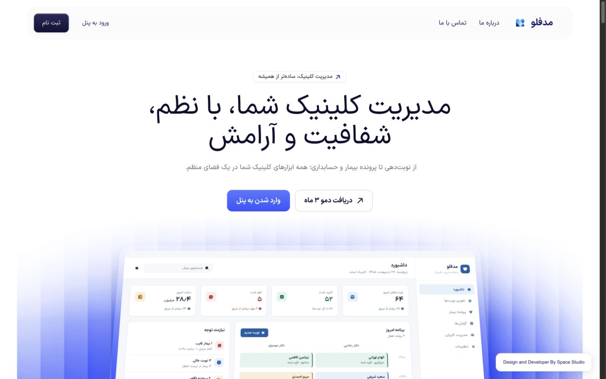
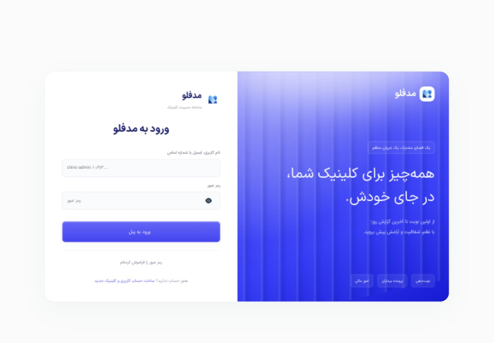
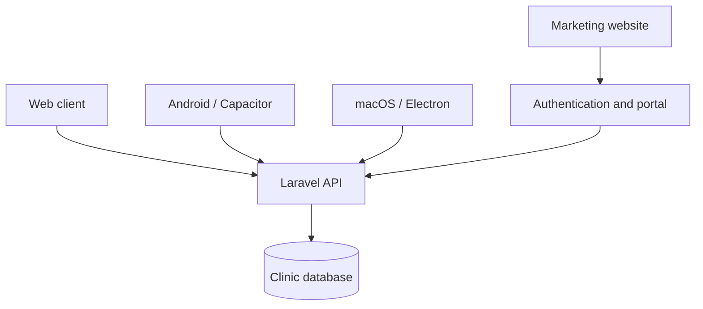

# MedFlow | مدفلو

**مدیریت یکپارچهٔ کلینیک — از نوبت‌دهی تا پروندهٔ بیمار و گزارش مالی**

A Persian clinic management platform with Web, Android and macOS clients, a marketing website and an administration portal.

**Developed & integrated by [Space Studio](https://space-studio.ir)**

[وب‌سایت مدفلو](https://medflow-app.ir) · [ورود به سامانه](https://panel.medflow-app.ir/login) · [Space Studio](https://space-studio.ir)

## دربارهٔ پروژه

مدفلو برای گردآوری کارهای روزانهٔ کلینیک در یک محیط فارسی طراحی شده است: مدیریت نوبت‌ها، پروندهٔ بیماران، کاربران و نقش‌ها، امور مالی و گزارش‌ها. کلاینت مشترک وب در پوسته‌های اندروید و macOS نیز استفاده می‌شود و از طریق API به بک‌اند Laravel متصل است.

این نمونه‌کار علاوه بر سامانه، سایت معرفی محصول، ورود و ثبت‌نام، پنل مدیریت پلتفرم و جریان اشتراک را در بر می‌گیرد. تمرکز کار بر تجربهٔ فارسی و راست‌به‌چپ، هماهنگی هویت بصری و اتصال بخش‌های مختلف محصول بوده است.

## بخش‌های محصول

| بخش | قابلیت‌ها |
| --- | --- |
| سامانهٔ کلینیک | داشبورد، نوبت‌دهی، پروندهٔ بیمار، گزارش‌ها و مدیریت کاربران |
| مدیریت دسترسی | احراز هویت، نقش‌های کلینیک و جداسازی دسترسی پلتفرم |
| اشتراک و امور مالی | کاتالوگ دوره‌ها، وضعیت اشتراک و تأیید دستی پرداخت توسط مدیر پلتفرم |
| سایت معرفی | صفحات محصول، محتوای فارسی، نمایش واکنش‌گرا و فرم تماس |
| پنل پلتفرم | مدیریت کلینیک‌ها، اشتراک‌ها، گزارش پرداخت و انتشار مقاله |
| کلاینت‌ها | وب، Android با Capacitor و macOS با Electron |

## تجربهٔ ورود

تصاویر، نمای رابط محصول و سایت هستند. این مخزن هیچ پروندهٔ بیمار، اطلاعات حساب یا اطلاعات دسترسی ارائه نمی‌کند.

## معماری و فناوری

| لایه | فناوری |
| --- | --- |
| بک‌اند | PHP، Laravel، API، migration و تست‌های PHPUnit |
| فرانت‌اند سامانه و پنل | HTML، CSS، JavaScript و رابط فارسی RTL |
| وب‌سایت معرفی | قالب Framer با بومی‌سازی فارسی و ابزار ساخت استاتیک Python |
| اپ اندروید | Capacitor |
| اپ دسکتاپ | Electron |
| داده | تنظیمات محلی MySQL / SQLite؛ جزئیات استقرار مستقل از این معرفی |
| اعتبارسنجی | Node test runner، PHPUnit و بررسی ساخت/مسیرهای سایت |

قالب پایه، فونت‌ها و کتابخانه‌های شخص ثالث متعلق به صاحبان اصلی خود هستند. نقش Space Studio در این نمونه‌کار، توسعهٔ سامانه، بومی‌سازی، سفارشی‌سازی و یکپارچه‌سازی محصول است.

## English overview

MedFlow brings appointments, patient records, clinic users, financial workflows and reporting into a Persian interface. A shared JavaScript client serves the browser and is packaged for Android with Capacitor and macOS with Electron. The Laravel backend handles application data and access boundaries, while a separate portal supports clinic onboarding, subscription administration and publishing.

The project also includes a localized marketing website and a consistent authentication experience. This repository is the public portfolio presentation. Implementation source and licensed assets are maintained in a separate private repository. Repository contents do not grant access to live accounts, a demo login, application data or paid services.

## لینک‌ها و دسترسی به سورس

- معرفی محصول: [medflow-app.ir](https://medflow-app.ir)
- پنل سامانه: [panel.medflow-app.ir](https://panel.medflow-app.ir/login)
- توسعه و ارتباط: [Space Studio](https://space-studio.ir)

سورس سامانه، سایت و پنل در مخزن خصوصی نگه‌داری می‌شود. این مخزن برای معرفی نمونه‌کار است؛ تصاویر و هویت محصول برای بازتوزیع یا استفاده در محصول دیگر مجوز داده نشده‌اند.
